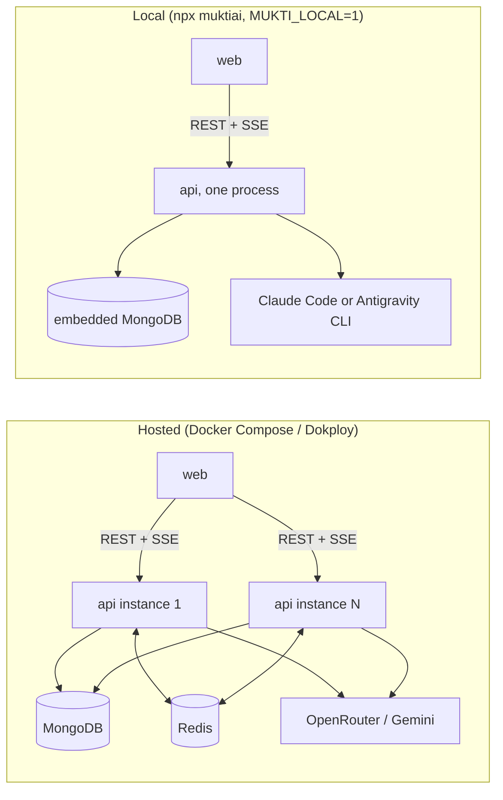
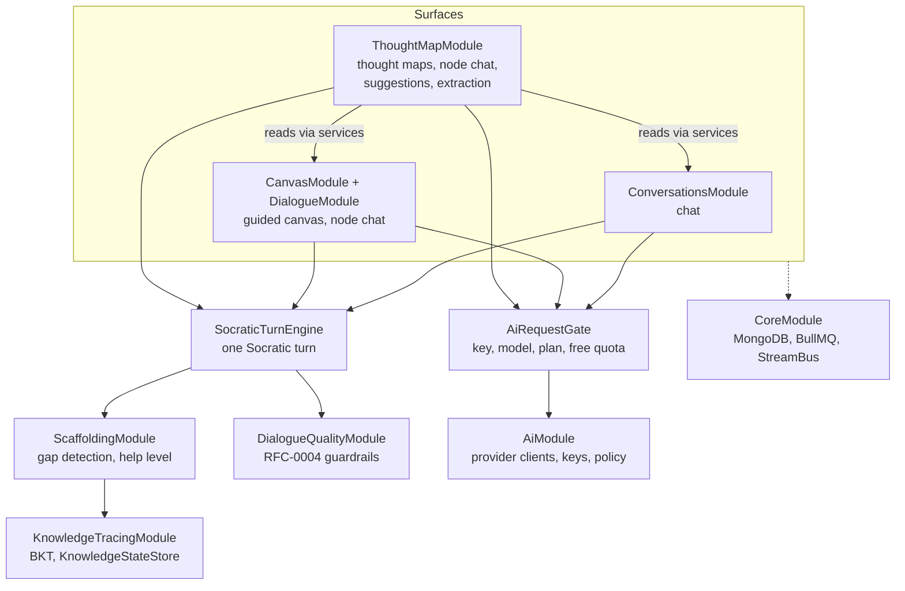
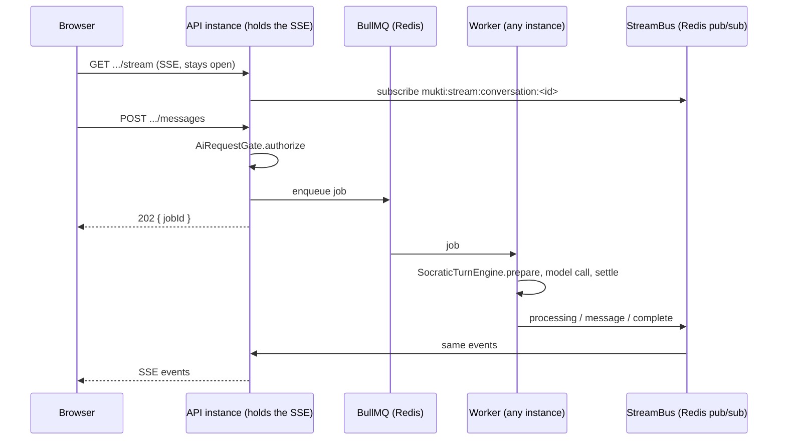

# Mukti Architecture

How Mukti is put together, as it is in the code. For feature status see the RFCs in
[`docs/rfcs`](../../rfcs/README.md); for how to run it see [`DEVELOPMENT.md`](../../../DEVELOPMENT.md)
and [`docs/local-mode.md`](../../local-mode.md).

> The diagram image [`images/mukti-architecture.png`](./images/mukti-architecture.png)
> predates this page and shows an aspirational cloud stack (CDN, Kubernetes, S3,
> payments) that Mukti does not use. The Mermaid diagrams below are current.

## Packages

| Package              | What it is                                                                                     |
| -------------------- | ---------------------------------------------------------------------------------------------- |
| `packages/mukti-api` | NestJS 11 API. All business logic, AI calls, queues and live streams.                          |
| `packages/mukti-web` | Next.js 15 app (App Router, TanStack Query, Zustand). Talks to the API over REST and SSE.      |
| `packages/mukti-cli` | `npx muktiai` launcher. Starts the prebuilt API and web locally with an embedded MongoDB.      |
| `packages/mukti-mcp` | Standalone MCP server over stdio. Shares the questioning-technique vocabulary, no shared code. |

## Two ways it runs

- **Hosted.** MongoDB for data, Redis for BullMQ job queues and the cross-instance stream
  bus. AI runs on OpenRouter with the server's key (counted against a daily free
  allowance) or on the user's own encrypted key. Email is SendGrid. Auth is JWT access
  tokens plus refresh tokens stored in MongoDB, with Google OAuth.
- **Local.** One process, no Redis: queue jobs run inline and stream events stay
  in-process. Sign-in is skipped. AI runs on a CLI the user already has signed in.

## Inside the API

The rules that hold this together:

- **One gate before every AI request.** Controllers call `AiRequestGate.authorize()`
  before enqueuing any job that calls a model. It resolves key ownership, plan and
  model, and consumes a free message when the server's key will be used.
- **One Socratic turn.** Chat, canvas node chat and thought-map node chat all run
  `SocraticTurnEngine`: `prepare` (gap detection, quality directives, scaffold context),
  `inspectReply`, then `settle` (grade the reply, move the help level, update
  knowledge). Each surface keeps only its own prompt, storage and streaming.
- **One writer for learner knowledge.** `KnowledgeStateStore.applyObservation` is the
  only code that writes `knowledge_states`, as a compare-and-set on `attempts`. Scaffold
  level and counters are written only if no other turn changed them first.
- **Modules read other domains through services.** Thought maps read conversations
  through `ConversationService` and canvas sessions through `CanvasService`, not their
  models. Module dependencies are one-way; there is no `forwardRef`.

## A reply, end to end

Jobs may run on a different process than the one holding the browser's stream, so
stream services publish through the global `StreamBus` (Redis pub/sub when hosted,
in-process when local). Each stream has its own Redis channel
(`mukti:stream:{namespace}:{key}`, e.g. `mukti:stream:conversation:<id>`). An instance
subscribes to a channel when it gains its first connection for that stream and
unsubscribes when it loses its last, so events reach only the instances that hold
the stream. Order within a job is preserved because Redis keeps per-publisher,
per-channel order.

Pub/sub does not buffer, so a stream only receives what is published after its
subscription lands. `StreamBus.track` resolves at that point. Map extraction is the
one stream whose job is enqueued before the client connects, so its SSE endpoint
waits for `track` and then re-checks the job. If the job finished during that gap,
the endpoint replays the stored result and skips anything already sent live.

## Contracts between web and API

Every SSE stream's event shapes (chat, canvas and map node chat, branch suggestions,
conversation-to-map extraction) are defined once in the private, type-only workspace
package `@muktiai/contracts` (`packages/mukti-contracts`). The API's stream services
alias those types, and the web compiles a two-way equality check against them
(`packages/mukti-web/src/types/stream-contract.check.ts`), so drift fails `tsc` and
`next build`. The package is never published: imports are `import type`, so they
vanish from the API's runtime JavaScript.
