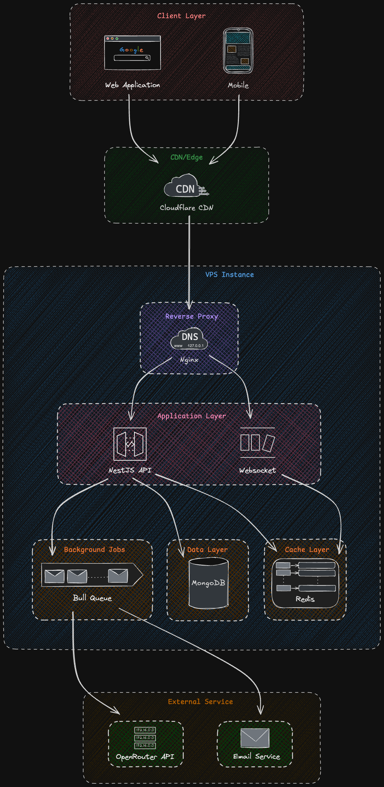

# Mukti Architecture

The architecture overview lives in
[`docs/reference/architecture/overview.md`](../docs/reference/architecture/overview.md):
the packages, how hosted and local mode differ, the module map of the API, and how a
reply travels from the browser to a worker and back.

  

The image above is the original sketch and shows infrastructure Mukti does not use
(CDN, Kubernetes, S3, payments). The overview's diagrams are current.
