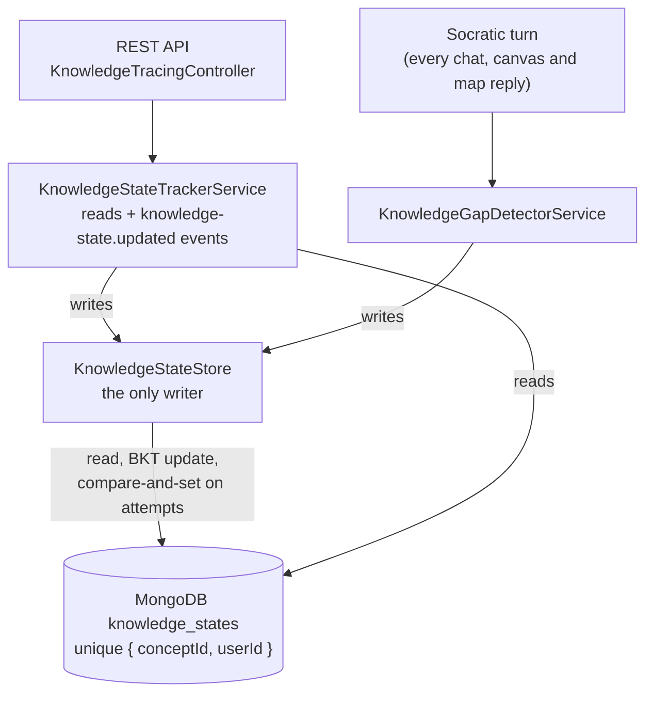

# Knowledge Tracing Module

Implementation of **Bayesian Knowledge Tracing (BKT)** for user knowledge state estimation in Mukti.

## Overview

This module tracks user mastery of concepts using the 4-parameter BKT probabilistic model. It provides:

- **Real-time knowledge state updates** based on user responses
- **Intelligent recommendations** for next learning actions
- **Concurrency-safe writes**: overlapping turns, job retries and multiple API instances never lose an observation
- **Event-driven integration** for analytics and adaptive learning systems

## BKT Model

Bayesian Knowledge Tracing uses 4 parameters to model knowledge acquisition:

| Parameter             | Symbol   | Description                               | Typical Range | Default    |
| --------------------- | -------- | ----------------------------------------- | ------------- | ---------- |
| **Initial Knowledge** | `pInit`  | Probability user already knows concept    | 0.0 - 1.0     | 0.3 (30%)  |
| **Learning Rate**     | `pLearn` | Probability of learning per interaction   | 0.0 - 1.0     | 0.15 (15%) |
| **Slip Probability**  | `pSlip`  | Error despite knowing (careless mistake)  | 0.0 - 0.3     | 0.1 (10%)  |
| **Guess Probability** | `pGuess` | Correct despite not knowing (lucky guess) | 0.0 - 0.5     | 0.25 (25%) |

### Algorithm

```typescript
// Step 1: Compute posterior P(L_n | observation) using Bayes' theorem
if (correct) {
  posterior = (P(L) * (1 - P(S))) / [P(L) * (1 - P(S)) + (1 - P(L)) * P(G)];
} else {
  posterior = (P(L) * P(S)) / [P(L) * P(S) + (1 - P(L)) * (1 - P(G))];
}

// Step 2: Apply learning rate
P(L_n + 1) = posterior + (1 - posterior) * P(T);
```

## Architecture



### Consistency Strategy

- **No in-process cache.** Reads go to MongoDB, so every API instance and the reply pipeline see the same value. An earlier per-process cache served stale P(L) across instances and was removed.
- **One writer.** `KnowledgeStateStore.applyObservation` reads the record, applies BKT, and writes only if `attempts` is unchanged. If another turn wrote first it re-reads and re-applies, up to 5 times.
- **Creation race.** When two first observations arrive together, the loser hits the unique index and then updates the winner's record.
- **Parameters are fixed at creation.** BKT parameters sent to `POST /knowledge-tracing/update` only apply when the record is first created. An existing record keeps its stored parameters.
- **Failure isolation.** In the Socratic turn a failed knowledge write is logged, not thrown: the reply is already saved, and a job retry would store and bill it twice.

## API Reference

### Update Knowledge State

**Endpoint**: `POST /knowledge-tracing/update`

Updates knowledge state based on a user's response.

**Request Body**:

```json
{
  "userId": "user_123",
  "conceptId": "algebra_linear_equations",
  "correct": true,
  "pInit": 0.3, // optional
  "pLearn": 0.15, // optional
  "pSlip": 0.1, // optional
  "pGuess": 0.25 // optional
}
```

**Response**:

```json
{
  "state": {
    "conceptId": "algebra_linear_equations",
    "userId": "user_123",
    "currentProbability": 0.72,
    "attempts": 5,
    "correctAttempts": 4,
    "lastAssessed": "2026-02-28T10:30:00.000Z",
    "parameters": { "pInit": 0.3, "pLearn": 0.15, "pSlip": 0.1, "pGuess": 0.25 }
  },
  "posteriorBeforeLearning": 0.65,
  "posteriorAfterLearning": 0.72,
  "isMastered": false,
  "recommendation": "practice"
}
```

**Recommendations**:

- `advance` - Mastered (≥95%), move to next concept
- `practice` - Close to mastery (70-95%), keep practicing
- `review` - Moderate (40-70%), review material
- `reassess` - Struggling (<40%), needs intervention

---

### Get Knowledge State

**Endpoint**: `GET /knowledge-tracing/state/:userId/:conceptId`

Retrieves current knowledge state for a user-concept pair.

**Example**:

```bash
GET /knowledge-tracing/user_123/algebra_linear_equations
```

**Response**:

```json
{
  "conceptId": "algebra_linear_equations",
  "userId": "user_123",
  "currentProbability": 0.72,
  "attempts": 5,
  "correctAttempts": 4,
  "lastAssessed": "2026-02-28T10:30:00.000Z",
  "parameters": { ... }
}
```

---

### Get User Progress

**Endpoint**: `GET /knowledge-tracing/user/:userId`

Retrieves all knowledge states for a user.

**Example**:

```bash
GET /knowledge-tracing/user/user_123
```

**Response**:

```json
{
  "userId": "user_123",
  "totalConcepts": 12,
  "states": [
    { "conceptId": "algebra_linear_equations", "currentProbability": 0.72, ... },
    { "conceptId": "calculus_derivatives", "currentProbability": 0.45, ... }
  ]
}
```

---

### Get Struggling Users

**Endpoint**: `GET /knowledge-tracing/concept/:conceptId/struggling`

Identifies users who need intervention for a concept.

**Example**:

```bash
GET /knowledge-tracing/concept/algebra_linear_equations/struggling
```

**Response**:

```json
{
  "conceptId": "algebra_linear_equations",
  "strugglingCount": 3,
  "userIds": ["user_456", "user_789", "user_012"]
}
```

---

### Get Mastered Users

**Endpoint**: `GET /knowledge-tracing/concept/:conceptId/mastered`

Identifies users who have mastered a concept.

---

### Reset Knowledge State

**Endpoint**: `DELETE /knowledge-tracing/state/:userId/:conceptId/reset`

Resets knowledge state (useful for re-teaching or error correction).

---

### Concurrency

Knowledge state is read straight from MongoDB (there is no in-process cache), and every BKT update goes through `KnowledgeStateStore`, a compare-and-set on `attempts`. Overlapping turns on the same concept, retries, and multiple API instances therefore never lose an observation.

## Usage Examples

### Basic Integration

```typescript
import { KnowledgeStateTrackerService } from './modules/knowledge-tracing/services/knowledge-state-tracker.service';

@Injectable()
export class QuizService {
  constructor(
    private readonly knowledgeTracker: KnowledgeStateTrackerService,
  ) {}

  async submitQuizAnswer(
    userId: string,
    conceptId: string,
    answer: string,
    correctAnswer: string,
  ) {
    const isCorrect = answer === correctAnswer;

    // Update knowledge state
    const result = await this.knowledgeTracker.updateKnowledgeState(
      userId,
      conceptId,
      isCorrect,
    );

    // Use recommendation for adaptive learning
    if (result.isMastered) {
      await this.assignNextConcept(userId);
    } else if (result.recommendation === 'reassess') {
      await this.notifyTeacher(userId, conceptId);
    }

    return result;
  }
}
```

### Custom Parameters per Concept

```typescript
// Harder concepts: lower pInit, higher pLearn
await knowledgeTracker.updateKnowledgeState(
  userId,
  'advanced_calculus',
  correct,
  {
    pInit: 0.1,
    pLearn: 0.2,
  },
);

// Multiple choice questions: adjust pGuess
await knowledgeTracker.updateKnowledgeState(
  userId,
  'vocab_quiz',
  correct,
  { pGuess: 0.5 }, // 50% guess rate for true/false
);
```

### Event-Driven Integration

Listen to knowledge state updates for analytics or downstream processing:

```typescript
import { OnEvent } from '@nestjs/event-emitter';
import { KnowledgeStateUpdatedEvent } from './modules/knowledge-tracing/services/knowledge-state-tracker.service';

@Injectable()
export class AnalyticsService {
  @OnEvent('knowledge-state.updated')
  handleKnowledgeStateUpdate(event: KnowledgeStateUpdatedEvent) {
    console.log(`User ${event.userId} knowledge changed:`, {
      concept: event.conceptId,
      previousProbability: event.previousProbability,
      newProbability: event.newProbability,
      isMastered: event.isMastered,
      recommendation: event.recommendation,
    });

    // Send to analytics platform
    this.analytics.track('knowledge_state_updated', event);
  }
}
```

## Testing

### Run Tests

```bash
# Unit tests
bun nx run @mukti/api:test --testPathPattern=bkt-algorithm

# Integration tests
bun nx run @mukti/api:test --testPathPattern=knowledge-state-tracker

# Coverage
bun nx run @mukti/api:test:cov
```

### Test Coverage

The BKT algorithm is tested for:

- ✅ Correct probability updates (increase/decrease)
- ✅ Learning rate application
- ✅ Mastery threshold detection
- ✅ Recommendation logic
- ✅ Edge cases (P=0, P=1)
- ✅ Slip and guess probability correctness
- ✅ Parameter validation
- ✅ Mathematical correctness (manual verification)

## References

### Academic Papers

1. **Corbett, A. T., & Anderson, J. R. (1995)**. "Knowledge tracing: Modeling the acquisition of procedural knowledge." _User Modeling and User-Adapted Interaction, 4(4)_, 253-278.
   - Original BKT paper

2. **Baker, R. S., Corbett, A. T., & Aleven, V. (2008)**. "More accurate user modeling through contextual estimation of slip and guess probabilities in Bayesian knowledge tracing." _International Conference on Intelligent Tutoring Systems_, 406-415.
   - Improvements to parameter estimation

### Implementation References

1. **pyBKT** (Stanford CAHLR): https://github.com/CAHLR/pyBKT
   - Reference implementation in Python (248⭐)
   - Used for algorithm validation

2. **Ebisu.js**: https://www.npmjs.com/package/ebisu-js
   - Alternative: Beta-distribution based spaced repetition
   - More flexible than BKT for some use cases

### Why BKT?

- **Interpretable**: Each parameter has clear educational meaning
- **Proven**: 30+ years of research and production use
- **Efficient**: O(1) update per interaction
- **Adaptive**: Parameters can be tuned per concept or user
- **Research-backed**: Extensively validated in ITS systems (Carnegie Learning, ASSISTments, etc.)

## Roadmap

### Phase 1: Core BKT (✅ Complete)

- [x] BKT algorithm implementation
- [x] MongoDB persistence
- [x] In-memory caching
- [x] REST API endpoints
- [x] Event emission
- [x] Unit tests

### Phase 2: Parameter Tuning (Planned)

- [ ] EM algorithm for parameter learning from data
- [ ] Per-user parameter adaptation
- [ ] A/B testing framework for parameter optimization
- [ ] Parameter presets for different question types

### Phase 3: Advanced Features (Planned)

- [ ] Multi-skill BKT (concepts with dependencies)
- [ ] Forgetting curves integration
- [ ] Real-time dashboard for teachers
- [ ] Predictive analytics (time to mastery)

### Phase 4: Research Extensions (Planned)

- [ ] Deep Knowledge Tracing (DKT) - LSTM-based
- [ ] Performance Factor Analysis (PFA)
- [ ] Item Response Theory (IRT) integration

## Contributing

When contributing to this module:

1. **Preserve mathematical correctness** - BKT is a proven algorithm
2. **Add tests for new features** - maintain >90% coverage
3. **Document parameter changes** - educational implications matter
4. **Keep writes in `KnowledgeStateStore`** - never write `knowledge_states` directly

## License

MIT - See LICENSE file in repository root

---

Built for **Mukti** - Liberation through Guided Learning
